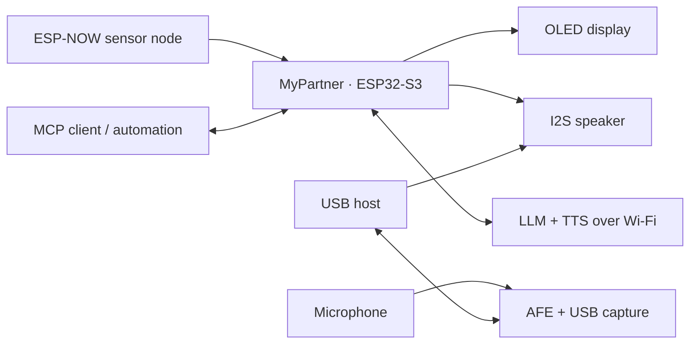

<div align="center">

<h1>ESP32-MyPartner</h1>
<p><strong>A little presence on your desk.</strong></p>
<p>An ESP32-S3 desk companion that shows expressions,<br>
reminds you of important things, senses the room, and exposes USB media.</p>
<p><code>ESP32-S3</code> · <code>FreeRTOS</code> · <code>ESP-NOW</code> · <code>MCP</code> · <code>Voice</code></p>

</div>

MyPartner is a physical companion designed to stay nearby: a small face on a
screen, a voice that greets you, and reminders that wait until someone is in the
room. Hourly reminder messages and free-form speech use an LLM and a TTS service over Wi-Fi.

> The repository is named **ESP32-MyPartner** and the device is called
> **MyPartner**. The firmware still refers to it as **Partner**.

## A look at MyPartner

These are rendered previews captured from the OLED framebuffer before flashing,
not photographs. The display renders at 128 × 64 pixels.

<table>
  <tr>
    <td align="center"><br><sub>Idle face</sub></td>
    <td align="center"><br><sub>Happy expression</sub></td>
  </tr>
  <tr>
    <td align="center"><br><sub>Speaking</sub></td>
    <td align="center"><br><sub>Clock</sub></td>
  </tr>
</table>

## What it can do

- **USB media** — UVC MJPEG camera, UAC microphone and speaker (16 kHz mono), and CDC control (help, ping, status, bootloader).
- **Stream audio** — the microphone remains available over the existing WebSocket and AFE capture paths. MultiNet and local greeting recognition are removed.
- **Announce the hour** — at each hour change in Western Indonesian Time
  (WIB), Partner generates a message with an LLM and reads it aloud using TTS.
- **Remember personal reminders** — create and manage reminders through MCP.
  Due reminders wait for a valid presence detection before being spoken.
- **Show expressions** — the OLED face blinks and reacts to its surroundings;
  screens and expressions can also be selected through MCP.
- **Sense the room** — receive temperature, humidity, and radar data from a
  compatible ESP-NOW sensor node. Radar reports presence and approximate
  distance, not identity.
- **Connect to AI clients** — MCP exposes tools, device information, and sensor
  resource change notifications through SSE.



## Hardware

The current configuration uses an ESP32-S3 DevKitC-1 N16R8, a 128 × 64 I2C OLED,
an INMP441 I2S microphone, a MAX98357A amplifier, and a speaker. An ESP-NOW
node with a DHT sensor and presence radar is optional. Adjust
[`include/hw.h`](include/hw.h) to match your wiring.

| Signal | GPIO |
|---|---:|
| OLED SDA / SCL | 4 / 5 |
| BOOT button | 0 |
| Microphone SD | 1 |
| Speaker DIN | 2 |
| Shared I2S BCLK | 42 |
| Shared I2S WS/LRC | 41 |

## Getting started

### 1. Prepare the project

The project depends on two Git submodules: `lib/AiProviderKit` and
`model/esp_sr` (ESP-SR). A plain `git clone` leaves them empty, so clone with
submodules:

```sh
git clone --recurse-submodules https://github.com/jahrulnr/ESP32-MyPartner.git
cd ESP32-MyPartner
```

If you already cloned without them, fetch them afterwards:

```sh
git submodule update --init --recursive
```

After pulling changes that move a submodule, run the same command again to
sync it.

Install [PlatformIO Core 6.1.19 or newer](https://platformio.org/) and connect the board over USB.
The default environment uses INMP441. Select `esp32-s3-analog-mic` for an analog ADC1 microphone on GPIO1.

Copy `include/secret.h.example` to `include/secret.h`, then configure Wi-Fi
and the API settings. `secret.h` is listed in `.gitignore`.

### 2. Upload the firmware

```sh
pio run -e esp32-s3-devkitc1-n16r8
pio run -e esp32-s3-devkitc1-n16r8 -t upload --upload-port /dev/ttyACM0
```

### 3. Flash the voice models

For a new board, initialize the ESP-SR submodule and flash the VAD model partition:

```sh
python3 tools/upload_voice_models.py --port /dev/ttyACM0
```

Use `--check` to validate the assets and partition size without flashing. Existing VAD + MultiNet partitions can still be used; MultiNet is not loaded.

Check the serial monitor for the IP address and service status. Adjust digital
microphone and speaker gain with `DEFAULT_MIC_VOLUME` and
`DEFAULT_SPEAKER_VOLUME` in [`include/app_config.h`](include/app_config.h).

## Connect with MCP

Connect an MCP client to `http://<PARTNER_IP>:83/mcp`, then start with
`contract()`. Example tools:

```text
info()
menu(screen="sensors")
expression(choose="happy")
speak(text="Hello, welcome back!")
reminder_create(text="Time to take a break.", after_seconds=600)
reminder_list()
```

Subscribe to `partner://sensors/presence` or `partner://sensors/climate` to
receive change notifications. The MCP client or automation application decides
what to do with each notification.

- [MCP, reminders, and sensor event guide](docs/mcp.md)

## Project status

MyPartner is an evolving experimental project. The display,
sensor nodes, reminders, and MCP are available; recognition quality and
connection reliability depend on the environment and hardware. TTS audio
streams to the speaker, while hourly LLM messages are currently collected in
full before TTS begins.

Run the available host checks from the workspace:

```sh
bash tools/test_host.sh
```

## USB camera wiring

The camera uses the MyMedia Freenove pin map: XCLK 15, SDA 4, SCL 5, D0–D7 11/9/8/10/12/18/17/16, VSYNC 6, HREF 7 and PCLK 13. SDA/SCL share the OLED bus. Microphone SD/analog OUT is GPIO1 and speaker DIN is GPIO2; BCLK and WS are GPIO42 and GPIO41. The analog microphone uses ADC1 channel 0 and 3.3 V. USB OTG must be connected separately from the UART upload port.
